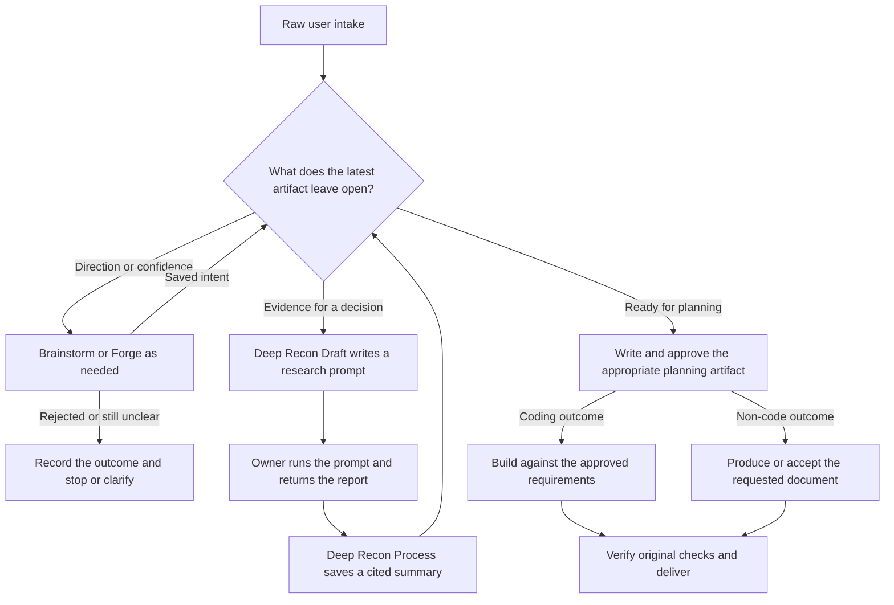

# Evaluator guide for blind Autonomous Delivery intake

Use this guide to score [projects 9–12](autonomous-delivery-smoke-projects.md#blind-idea-to-application-prompts). Keep it in a separate workspace from the Delivery session. Submit only the chosen project’s quoted intake. When Delivery asks a normal owner question, supply the requested facts, decisions, checks, or approval. Record the proposal before giving any workflow guidance.

## From a raw idea to a verified deliverable

A valid next step follows from a need in the intake or the latest saved artifact. Brainstorming helps when the direction is open. Forge Idea helps when a candidate needs pressure testing. Deep Recon helps when a decision requires evidence. A settled intent can go straight to the planning artifact the work needs. [Choose a planning path](../docs/plan/choose-a-planning-path.md) · [Explore and validate an idea](../docs/plan/explore-and-validate-an-idea.md)

In a research case, check that the returned report is processed into cited evidence before the plan relies on it. If the report leaves a decision-critical gap, expect the run to pause or seek the missing evidence. For a non-code case, the approved brief can be the final artifact or guide the production and verification of a separate requested output. [Research a decision](../docs/plan/research-a-decision.md) · [Define requirements and a specification](../docs/plan/define-requirements-and-a-specification.md)

**Score inference first.** Record the proposed route, rationale, artifact, and next action before giving any routing help. Accept a different path when it addresses the same open decision and preserves the owner’s constraints. Score later automatic transitions against the evidence in each saved artifact.

**Record the version boundary.** In v0.4.1, the plugin can infer an entry route and show a capability gate. Record the gate as the end of the automated portion when a handler is unavailable. If you continue the exercise with standalone BMad skills, record the manual handoffs and verify the final scoped Delivery result separately. A fully automated pass requires the plugin to select and complete the artifact handoffs as well as deliver the verified result. [Native delivery contract](../skills/method/bmad-deliver/references/run-record.md#beta-capabilities)

## Case notes

### 9. Community-room supply budget

- **Initial evidence.** The purchasing outcome is clear and the approach is open. Expect idea exploration or a focused question about how the room coordinator makes purchasing decisions.
- **Owner fixture.** If asked to pick a direction, choose the small calculator. Say that the room coordinator owns the trial and the prices are hypothetical. A Product Brief or short spec can carry that approved decision into implementation. [GOV.UK beta phase guidance](https://www.gov.uk/service-manual/agile-delivery/how-the-beta-phase-works)
- **Delivery evidence.** If asked, choose Mode C and name `supply_budget.py`. Verify that two items at 350 cents and three at 200 cents leave 200 cents from 1,500 and −100 cents from 1,200. Check that the saved planning artifact predates the build and supports the two checks. [Python numeric types](https://docs.python.org/3/library/stdtypes.html#numeric-types-int-float-complex)

### 10. Rainfall log summary

- **Initial evidence.** The owner wants evidence on distinguishing missing readings from zero before choosing a rule. Look for a research proposal tied to that decision.
- **Owner fixture.** When asked to return the research output, provide the resulting report. For an offline exercise, use a labeled synthetic report. After the report is processed, choose the rule that counts zero as a reading and omits missing entries. The garden coordinator owns that decision.
- **Delivery evidence.** If asked, choose Mode B and allow the code class and the exact label `rainfall.py`. Verify three readings with mean 3 for `[3, 0, None, 6]` and count 0 with a missing mean for an all-missing list. Retain the research prompt, returned report, cited summary, and approved requirements with the results. [Python statistics](https://docs.python.org/3/library/statistics.html)

### 11. Repair café queue ticket board

- **Initial evidence.** The check-in problem is clear and the solution is open. Give credit for exploring or pressure-testing an approach before settling on something to build.
- **Owner fixture.** When asked to choose, accept a local browser board. Confirm that tickets should be served in arrival order and that an empty queue needs a visible response. The floor lead owns the trial. Expect the approved spec or lightweight PRD to carry those behaviors forward. [GOV.UK moderated usability testing](https://www.gov.uk/service-manual/user-research/using-moderated-usability-testing)
- **Delivery evidence.** If asked, choose Mode A and approve the saved proposal when it fits. Verify that the delivered offline `index.html` serves Lamp, Radio, and Clock in that order and handles an empty queue. Use a trusted checker in code-server’s embedded Live Browser and keep its observations. [MDN DOM reference](https://developer.mozilla.org/en-US/docs/Web/API/Document_Object_Model)

### 12. Equipment reservation overlap guard

- **Initial evidence.** The intake supplies the overlap policy. A short requirements artifact and a local implementation are appropriate once any input details are settled.
- **Owner fixture.** If asked, use half-open time intervals with `reservations(kit_id, start_min, end_min)` and identify the equipment lead as decision owner. The given policy is sufficient evidence for the controlled fixture.
- **Delivery evidence.** If asked, choose Mode C and name `conflicts.sql`. With a saved reservation `(A, 600, 660)`, verify that A from 630 to 680 conflicts, adjacent A from 660 to 690 is allowed, and B from 630 to 680 is allowed. Bind the checker’s SQLite observations to the delivered query. [SQLite SELECT reference](https://www.sqlite.org/lang_select.html)
