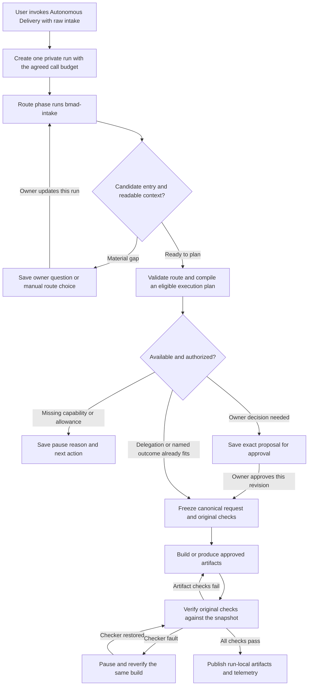

# BMad intake as the Autonomous Delivery route phase

- **Status** — Increment 5 is complete. Autonomous Delivery Beta v0.4.0 passed release qualification and is the current private hosted release.
- **Rollback baseline** — The v0.3.0 archive and its separate installed copy remain available. The candidate resumed archived code, Product Brief, and mixed runs. The old runtime refused raw-intake state without modifying it.
- **Host qualification** — Codex has the signed-in intake smoke from Increment 3 and local package verification. Claude Code workspace intake remains a preview with deterministic verification.
- **Release files** — [Portable plugin](delivery-beta/autonomous-delivery-beta-0.4.0.zip) · [Standalone skill](delivery-beta/bmad-deliver-beta-0.4.0.zip) · [Archive checksums](delivery-beta/autonomous-delivery-beta-0.4.0.zip.sha256)

## 1. Product and architecture decision

`bmad-intake` is the in-run routing component of `bmad-deliver`. The user invokes Autonomous Delivery with the material they have. The controller creates one saved run and calls Intake during its existing `route` phase. That run records the chosen entry point, any questions or approvals, the selected execution plan, verified outputs, and telemetry.

Intake answers **which of the eight BMad entry points fits**. Delivery code answers **what that entry point is currently able and authorized to execute**, and compiles the selection into specific steps. The same classification can produce a ready run, a source-preparation step, an owner decision, or a capability pause. The user sees which case applies before implementation starts.

The first upgrade makes all eight routes selectable inside a run and preserves the existing verified native paths. It enables additional execution handlers in stages, beginning with source intake. Every handler gains its own terminal evidence and acceptance checks before the plugin advertises end-to-end execution for it. V1 uses a bounded LLM call through the current signed-in coding host. The planned System One upgrade changes the classifier while keeping the run, authority, execution, receipt, and verification contracts. [Eight-route BMad map](../_bmad-output/autonomous-delivery-route-map/bmad-method-route-map.html) · [Current Delivery contract](../skills/method/bmad-deliver/references/run-record.md) · [U8 expansion proposal](delivery-review.md)

### Why the plugin needs an upgrade

| Current implementation | Required change |
| --- | --- |
| `deliver.py start` requires a full `--request`, including output class, owner authority, checks, and budget, before it reaches `route`. | Add a raw-intake start path that opens the same controller run while the delivery request is being formed. Retain the structured start contract for existing callers. |
| The route receipt names a deliverable and workflow sequence. Code validates the native sequence against `code`, `non-code`, or `mixed`. | Add a versioned classification receipt with one of the eight entry IDs. Use a deterministic adapter to produce a trusted execution plan and apply the current authority checks. |
| The native runner recognizes Build Auto and Product Brief and validates specific terminal evidence for both. | Preserve those handlers and their order. Add a capability registry with workflow-specific validators and enable additional handlers only after they pass tests. |
| Status, recovery, and telemetry assume a canonical request already exists. | Support a saved intake with a pending request. Show what the owner needs to do and allow the controller to resume without losing the intake or issuing duplicate calls. |

Evidence for these dependencies is in [the controller](../skills/method/bmad-deliver/scripts/deliver.py), [the native host helper](../skills/method/bmad-deliver/scripts/native_host.py), and [the package allowlist](../skills/method/bmad-deliver/scripts/bundle_layout.py).

## 2. The eight entry points inside Delivery

The IDs match the published route map. An entry point describes intent. The delivery output class still describes the owner-approved artifacts. The route and execution plan preserve both values independently. For example, a small browser game and guide can be `small` with output class `mixed`, and a project can start with a `non-code` planning packet when that is what the owner wants delivered.

| Route | When it fits | First executable path and deliverable boundary |
| --- | --- | --- |
| `sources` | The immediate ask is to process raw notes, papers, a finished literature review, transcripts, recordings, or documents. | Start expansion with `bmad-ingest` for cited notes. Add Deep Recon **Process** for a decision-focused synthesis and Shard Pro for maintained long text as separate handlers. A note can be the final deliverable or an approved input to the next step. |
| `unclear` | The owner wants options, pressure-testing, or evidence before choosing what to do. | Choose an appropriate Brainstorm, Forge, or Deep Recon handler. An owner-approved scope can end at a reviewable report, decision record, or hardened intent. Pause for the owner when further work changes the proposed outcome. |
| `thinking` | The desired output is a document or decision artifact. | Reuse the supported Product Brief workflow when it fits. Add specific handlers for PRD, PRFAQ, UX, architecture, and other document types only after each can prove its own output. |
| `trivial` | The owner requests an exact mechanical edit with low risk and an easy check. | For the first release, permit a supported run-local code path when authorized. Plan a smaller deterministic handler for a verified edit or patch against an approved snapshot. Applying a patch to an existing worktree has its own authority and verification. |
| `small` | One clear implementation objective can fit one Build session. | Use proven Build Auto for code. Use Build Auto followed by Product Brief when the approved mixed contract fits. Deliver the run-local artifacts with the original checks and evidence. |
| `existing` | The immediate goal is to establish or review existing repository context before choosing what to build. | Start with a verified local context report or proposed `AGENTS.md` block from a dedicated handler. Applying a change to a real repo requires explicit authority. A scoped edit in an existing repo keeps its sized route and carries repo context. |
| `epic` | One coherent outcome requires several build sessions. | Begin with Sofia’s requirements and ordered story packet, with owner review when needed. A later orchestration increment can execute enrolled stories one at a time and verify the combined epic. |
| `project` | Several epics, teams, or shared decisions need initiative-level coordination. | Begin with the applicable planning documents and initiative breakdown. Add integrated execution only after the orchestrator can enforce dependency order, shared requirements, and an evidence-based retrospective per epic. |

In v0.4.0 show execution availability for each route and subtype. The built-in execution set starts with the existing native code, Product Brief, and compatible mixed paths. A route that needs an unavailable handler stays visible in the same run with a specific next action. A trusted host-assisted handler can be added when it supplies the same validated evidence as a native handler. Mark a run `complete` only after it delivers its approved output and passes the original checks. If the owner orders a handoff outside the controller, record that handoff distinctly from completed delivery. [Planning paths](../docs/plan/choose-a-planning-path.md) · [Existing-codebase guide](../docs/existing-codebases/start-in-an-existing-codebase.md) · [Autonomous development loops](../docs/build/autonomous-development-loops.md)

### Route overlaps

1. Follow explicit route or workflow choices when the owner supplies them. Check capability, approval, and source permissions before dispatch. A request to resume a saved run starts at its persisted gate.
2. Keep the user’s requested outcome primary. “Write a PRD from these PDFs” is `thinking`. Mark missing readable content as a source prerequisite. “Turn these PDFs into a cited note” is `sources`.
3. Distinguish evidence gathering before a choice (`unclear`), processing a finished report for a decision (`sources`), and writing a requested decision document (`thinking`).
4. Use `existing` for an onboarding or context-management objective. Carry `existing_repo` as context when the owner has already scoped the work.
5. Use consequences, dependencies, and the number of independent outcomes to distinguish `trivial`, `small`, `epic`, and `project`. A permission change or production migration needs normal review and approval. Two independent deliverables with no stated order call for a focused owner question.
6. Keep unsupported formats and missing read access visible. Use a host-authorized PDF extraction or OCR with page references, or a timestamped transcript for audio or video the host cannot read. The router can record and classify the material from metadata. It does not need to decode the media to identify a blocker. [Ingest](../skills/core-tools/bmad-ingest/SKILL.md) · [Research a Decision](../docs/plan/research-a-decision.md) · [Prepare Long Documents](../docs/plan/prepare-long-documents-for-agents.md)

## 3. Run flow and owner authority



### Commands and state transitions

The following command forms are proposed. The skill writes the input envelope with the owner’s supplied material. Favor existing `status`, `resume`, `--answer`, `--approve`, `--retry`, and `--reverify` behavior where it already fits.

```bash
python3 deliver.py start "$RUN" --intake intake.json --codex --native-host
python3 deliver.py status "$RUN"
python3 deliver.py resume "$RUN" --answer 'OWNER ANSWER'
python3 deliver.py resume "$RUN" --approve "$PROPOSAL_ID"
```

`--intake` and `--request` are mutually exclusive. Keep `--request` and the legacy route-worker protocol for callers that already supply a complete structured request. The new user-facing plugin invokes the intake form for a new raw request. Add one structured owner update action, proposed as `resume --intake-update FILE`, when the owner needs to add source references, select a manual route, or supply multiple typed fields. It applies only during the intake gate. Plain resume reads saved decisions and committed receipts before dispatching anything.

| Gate or condition | Controller behavior |
| --- | --- |
| Before the first dispatch | Require a positive, owner-authorized call budget, a bounded timeout, and an eligible host before spending a model call. Store what is supplied and request missing authority without inventing it. |
| `answer-required` | Ask for the smallest missing fact that would change route or execution. A missing transcript, ambiguous goal, or unclear scope can leave a proposed route visible. An owner update reuses the same run. |
| Proposed `capability-unavailable` | Show the selected entry point and unavailable handler or prerequisite. Resume after the supported capability is available, or seek explicit authority for a different deliverable or handoff. Keep `complete` reserved for verified delivery. |
| `approval-required` | Save the exact proposed outcome, output names, workflow steps, owner limits, typed checks, intake revision, and proposal ID. Approval is bound to that proposal. Any material update invalidates the earlier approval for the changed proposal. |
| Eligible to build | Atomically freeze the canonical request, original check IDs, authorized references, and ordered execution plan. Begin only the first eligible step. |
| Interrupted or budget exhausted | Retain the same run and approved request. Adopt a valid committed receipt before retry. Extend the existing budget only through the owner-authorized action. |
| Checker fault | Keep the saved build. Repair the checker and resume verification through the current `--reverify` contract. |
| Proposed `subscription-paused` | Pause further model dispatch. Show whether the owner can choose an available manual route, supply the missing input, or resume after the allowance resets. Keep saved artifacts and approvals. |

**Mode A** always presents the proposed delivery for approval before building. **Mode B** may advance when the explicit owner delegation, output class and name boundaries, source permissions, and original checks cover the proposed plan. An actual boundary conflict requires an owner decision on a compatible scope. **Mode C** preserves the owner-named deliverable, with the existing replacement approval rule. Preserve explicitly supplied constraints and tests. Ask the owner to adopt proposed acceptance criteria if the intake supplied none. A classifier, attachment, or tool output never becomes the owner’s authority. Once the original request is frozen, changing the requested outcome or dropping an original check calls for a separately authorized new request linked to this one. [Mode B delegation and receipt recovery](../skills/method/bmad-deliver/references/run-record.md)

## 4. Contracts, persistence, and data handling

| Record | Proposed contents |
| --- | --- |
| **Intake envelope** | Owner text, immutable source IDs, access and readability flags, authorized excerpt references, host facts, explicit limits, requested budget, and an intake revision. Record the original input so the user can trace the decision. |
| **Classifier result** | One catalog ID or an explicit defer, optional subtype and ranked alternatives, validated reason codes, and optional supplied source IDs or probabilities. Keep evidence nullable for typed models. The protocol carries a run/attempt binding and intake revision. |
| **Compiled execution plan** | Catalog and policy versions, selected entry point, output class, one or more allowlisted ordered handler IDs, their verification capabilities, and references to required prerequisites. Code owns this record. |
| **Canonical delivery request** | The existing request shape with frozen owner authority, original checks, budget, and input. It is present before build starts. Store the proposed draft separately while owner review is pending. |
| **Run state and receipts** | Preserve `state.json`, ordered attempts, job and receipt files, and the existing run lock and same-attempt receipt lock. Store the accepted intake decision and a stable step identity so a retry can target the right work. |

Example at the boundary between classification and execution. The classifier selects only `small`. The controller derives the rest from the catalog, installed workflows, and the owner's named mixed deliverable and checks.

```json
{
  "phase": "route",
  "attempt_version": 2,
  "intake_version": 1,
  "intake_revision": 1,
  "classification": {"route_id": "small", "source": "llm"},
  "execution_plan": {
    "output_class": "mixed",
    "handlers": ["bmad-build-auto", "bmad-product-brief"],
    "original_check_ids": ["browser_loads", "brief_matches_game"]
  }
}
```

The example shows the proposed state boundary. Implementation should keep provider replies and canonical request data in their own validated records. In the same run, a manual route choice can produce the same execution plan and check IDs.

### Compatibility design

- Mark raw-intake runs with a new attempt protocol version, proposed `attempt_version: 2`, and a small intake payload version. The v0.3.0 reader rejects an unsupported attempt version, so these runs get a clear older-runtime error. Preserve the original marker for existing runs, including on subsequent writes. Keep verification v2 for new intake runs and increment it only when the evidence protocol changes.
- Allow `request: null` while the intake substep is active. Introduce explicit guards for the code paths that currently assume `request` exists, including job construction, receipt validation, summary, metrics, recovery, and the transition to build. Report a pending request before verification applies and allow a saved owner gate with zero attempts. Classifier jobs receive an intake envelope and a versioned route receipt contract. Build and verification jobs receive the canonical request and existing typed evidence contract.
- Store the specific workflow IDs, plan hash or versioned digest, and approved source snapshot binding once the execution plan is accepted. Resume the pinned plan even after a catalog or plugin update. Validate each receipt against its attempt, intake revision, expected handler, allowed text artifact names, and evidence. Reuse the existing mechanism that lets a valid late receipt win before retry. If the outcome of an already claimed step cannot be established, pause to reconcile it before another dispatch.
- Preserve v0.3.0 saved runs and custom-worker callers. Test legacy v1 prose verification and v2 typed verification, complete and pending states, and old receipts written before the surviving controller resumed. New route receipts must be recognizable before being parsed as existing route or build receipts. [Run reader and receipt validator](../skills/method/bmad-deliver/scripts/deliver.py) · [Native host helper](../skills/method/bmad-deliver/scripts/native_host.py)

### Bounded inputs and accounting

Keep source authorization in the host. The classifier receives the user’s bounded request, coarse metadata, and authorized text excerpts with opaque source IDs. Retain raw files, absolute paths, and credentials in private host storage. Explicitly authorize source retention before using an Ingest handler that copies the original. Keep source content and excerpts out of exported telemetry. For source-inspection checks, keep an approved readable snapshot with exact locators and validate it against the required source. A private original can be referenced with owner permission. It does not need to enter a worker receipt or delivered artifact.

Every dispatched intake classifier call, prerequisite worker, build, or verification uses the controller’s existing dispatch accounting. The new classifier replaces the existing route call for an ordinary intake. Aim for **three** dispatches for supported code or a brief and **four** for compatible mixed output when a single classifier call suffices and every stage succeeds. A deterministic owner selection can finish routing without a model call. If an intake needs a second model decision, source preparation, or a repair, count each new dispatch and stop at the cap. Existing receipt and adapter byte limits and the owner-controlled budget extension remain part of the current interface. [Dispatch accounting and limits](../skills/method/bmad-deliver/references/run-record.md)

### Subscription usage and diagnostics

Use the current user-owned subscription setup for both Intake and Delivery. Codex’s built-in `--codex` worker runs `codex exec` with the selected CLI authentication. The local Codex CLI reported ChatGPT sign-in on 2026-11-27. Claude Code follows the workspace-host pattern when signed in with the owner’s Claude subscription. Verify its actual routing worker, native host, and reviewer paths during the pilot. The local Claude CLI was signed out during the baseline check. Exact allowance available and paid continuation settings are determined by each account. [Codex authentication](https://learn.chatgpt.com/docs/auth) · [Codex worker](../skills/method/bmad-deliver/scripts/codex_worker.py) · [Claude Code subscription setup](https://support.claude.com/en/articles/11145838-use-claude-code-with-your-pro-max-or-ultra-plan)

The subscription-only path covers routing, native workflow calls, review calls, and any model-assisted verification. The existing trusted local checker can verify behavior within the same run. Keep credential overrides and separately billed fallback outside this path. Confirm that the selected host can pause before drawing paid usage. A signed-in Codex session can use available purchased credits after included usage is exhausted. Claude Code can switch billing paths when alternate credentials are present. When eligibility is uncertain, pause model dispatch and offer manual intake within the run. Keep provider allowance distinct from the number of controller attempts. [OpenAI credit behavior](https://help.openai.com/en/articles/12642688-using-credits-for-flexible-usage-in-chatgpt-personal-plans) · [Claude credential behavior](https://support.claude.com/en/articles/12304248-manage-api-key-environment-variables-in-claude-code)

Extend the existing shareable `telemetry.json` projection with allowlisted route ID, catalog version, decision source, fixed reason and gate labels, attempt counts, and recorded duration and usage where available. Older runs export missing intake fields as unknown. Keep exact source and artifact content, account details, prompt text, owner answers, and raw model results private. Verify that usage pauses, route corrections, and late receipt adoption can be diagnosed from the exported record. [Current telemetry projection](../skills/method/bmad-deliver/scripts/run_telemetry.py)

## 5. Implementation and plugin upgrade sequence

| Increment | Work | Exit evidence |
| --- | --- | --- |
| **1. Freeze behavior and define upgrade fixtures** | Use the eight exact IDs. Freeze boundary examples, the existing v0.3.0 worker contract, and representative saved states. Record the first-release execution matrix. Proposed core files include `skills/method/bmad-deliver/references/intake-routes.json` and `skills/method/bmad-deliver/scripts/intake_router.py`. | Fixtures cover all eight decisions, multiple owner authority modes, and code/brief/mixed parity. Route IDs match the interactive map. |
| **2. Implement the in-run gate offline** | Extend `deliver.py` start, resume, validation, dispatch, and status. Add an intake-tagged route job and fake classifiers. Compile the first executable plan from a fixed catalog. Exercise canonical request freeze, unavailable routes, and manual correction. | A raw run can pause and resume through route, accept a real owner decision, and deliver a typed test artifact without a second run or an LLM. Legacy structured runs still work. |
| **3. Connect the subscription-backed LLM** | Enable the new contract through the installed Codex adapter. Serve the same jobs from the Claude Code workspace using a supported trusted worker integration. Update the Delivery skill so raw user input enters the integrated route. Validate responses against enums and input-derived references. | One bounded classification in the normal path. Pauses and coverage are measurable, no automated fallback to paid use, and signed-in host smoke tests cover both supported environments before advertising them. |
| **4. Add recovery and telemetry coverage** | Test death before and after receipt, concurrent retry and late submission, stale approvals, duplicate confirmation, source failures, and provider pauses. Verify offline export behavior and compatibility with saved v0.3.0 runs. | Exactly one result is adopted per attempt. Existing artifact hashes and verifier feedback survive resume. The diagnostic export contains zero planted private strings. |
| **5. Rebuild and release v0.4.0** | Update `SKILL.md`, run-record and native-host guides, compatibility checker, bundle allowlist, builder, and held-out evaluation notes. Bump the proposed plugin manifest and displayed controller version together. Keep previous archives and saved runtimes available. | Two byte-identical builds from pinned inputs, valid manifest checksums, a locally installed copy, both host smoke results or an explicit support limit, and rollback evidence. Update the private hosted plugin after the candidate passes. |
| **6. Turn on more executable routes incrementally** | Add Ingest first with an authorized raw-source policy and validated terminal evidence. Then evaluate Deep Recon Process, Forge or Brainstorm, supported planning documents and context reporting, and later ticket orchestration. Register each handler with its own input, terminal record, artifact contract, and verifier. | For each added handler, a fresh real or redacted task reaches its promised artifact with verified source or runtime evidence and a clear owner verdict. Existing handler tests remain green. |
| **7. Pilot the System One classifier** | Add a separately approved Jev or equivalent adapter against the same classification interface. Run shadow evaluation, calibrate, canary, then decide whether to promote. | Quality floor met on the frozen workflow holdout, improvement measured relative to the subscription-backed LLM, and switch-back tested on a saved run. |

Increment 5 changes the hosted plugin only after candidate verification. Test and preserve the prior private release archive and pin workers to the version that owns their state format. If a candidate stops being suitable for new starts, restore the prior launcher for new work and retain a compatible copy for runs already using the intake protocol. Exercise restoration with a v0.3.0 saved run and prove that the old reader refuses a new raw-intake run. Keep the handoff branch policy for any later authorized push. [Package builder](../tools/package_delivery_beta.py) · [Bundle layout](../skills/method/bmad-deliver/scripts/bundle_layout.py) · [Installed runtime checker](../skills/method/bmad-deliver/scripts/check_install.py) · [Prior release evidence](handoff-u7-telemetry.md)

### Expansion beyond the first release

For `sources` as a prerequisite, give the source-preparation step an owner-approved scope before retaining originals. Its receipt identifies a cited note and its source binding. Keep that intermediate private until the final approved deliverable or check calls for it. For a downstream classification or planning step, reuse the same intake run and count any new dispatch. If authorizing a change to an already-frozen deliverable would materially change original acceptance, use a linked new request.

For `epic` and `project`, distinguish a planning deliverable from full implementation. A planning packet can be verified and published when that is the agreed outcome. Full execution eventually requires an orchestrator to bind each story to the approved requirements and initial snapshot, enforce readiness and parent budgets, and save each dispatch and result. Model one story per Build Auto invocation. Prove dependency ordering, interruption recovery, shared constraint preservation, consolidated verification, and epic acceptance before labeling the parent complete. Until this implementation exists, keep plans, verified eligible steps, and owner handoffs clearly visible as separate outcomes. [Ticket planning and status](../docs/plan/break-work-into-stories-and-track-it.md) · [Epic acceptance](../docs/build/finish-an-epic.md)

## 6. Verification and release criteria

### Scenarios to prove before release

| Case | Expected evidence |
| --- | --- |
| Raw “build a browser memory-palace game and a launch guide” | Integrated route `small`, output class `mixed`, same run through Build Auto, brief, and independent verification. At most four normal dispatches when the contract fits. |
| Files only, including an unreadable recording | Durable intake. Ask what the owner wants and request a readable transcript or authorized preparation when essential. No build dispatch while waiting. |
| “Write a PRD from these interviews” | `thinking` with source references. If the PRD handler is unavailable, show that fact and the owner’s next action. The brief handler is used only when the actual approved output fits it. |
| “Turn this literature review into evidence for a decision” | `sources` and Deep Recon Process. The first release may pause for that capability. Once enabled, cite the source and verify the agreed summary. |
| Existing-repo onboarding, a typo, a normal behavior change, a coherent epic, and a cross-team initiative | Respectively `existing`, `trivial`, `small`, `epic`, and `project`. Mock only execution that is outside a route’s current release capability, and check that those cases surface the right gate. |
| Uncertain idea with two requested directions | `unclear` or a focused question, according to the gold label. Intake records the owner’s choice and continues in the same run. |
| Malformed worker receipt or unsupported handler ID | Validated failure and a recoverable gate. A model-supplied value cannot invoke a skill from outside the catalog. |
| Mode A approval, Mode B exact allowlist, Mode C named deliverable | Verify acceptance and refusal cases, including a model-suggested replacement, and stale/duplicate approvals. The original check set survives. |
| Crash, late reply, and exhausted budget during route | Recover the latest eligible receipt once. Confirm budget extensions and allowance recovery use the existing run and do not recreate its pending dispatch. |
| Proof docs contain instructions to change routing, approval, or authority | Use the actual owner request. Document material cannot create authority or cause execution on its own. |
| Quota exhausted, provider denial, or API-key-only authentication | Manual selection or safe pause before further model dispatch. Audit telemetry without exporting credentials or account data. |
| Saved v0.3.0 code/brief/mixed runs with incomplete and completed attempts | v0.4.0 reads and resumes the old protocols without silently moving them to Intake. Old runtime rejects the new intake protocol clearly. |

### Measure routing separately from delivery

- Build a disjoint development and frozen holdout set. Initial target is 40 clear cases per route and 80 ambiguous, multi-objective, or unsupported cases. Keep paraphrases and related projects on the same side of the split. Gold labels include the route, gate outcome, required source preparation, and first authorized execution step. Preserve meaningful alternative labels where human reviewers agree those are acceptable.
- Set proposed release floors of macro F1 at least 0.90 on clear cases and recall at least 0.85 per route. Count abstentions as misses on clear cases. Require at least 95% precision among ready recommendations and at least 80% coverage of clear cases. Require at least 90% correct gate behavior on ambiguous cases. Report counts, confusion pairs, and uncertainty for small samples.
- CI covers deterministic contracts and failure paths with fake providers. Separately authorized provider evaluations measure route quality, correction rate, pauses, p50/p95 latency, dispatch count, and observed subscription usage. Freeze the prompt, provider version, catalog, and data before running the holdout. Report how often the route reached an available executor and how many runs actually delivered and passed checks. Record the owner’s usefulness verdict separately.
- Before promoting the hosted build, run targeted Delivery and package tests, the full repository test suite, the documentation freshness routine, and a deterministic plugin rebuild. Run two matched install smokes, one per supported host, verifying an intake-to-artifact path and a routing pause. Include one saved-run compatibility replay and a rollback drill. Only share the allowlisted telemetry, synthetic fixtures, and authorized output evidence. [Freshness routine](../docs/reference/document-freshness.md) · [U7 evaluation evidence](delivery-u7/scorecard.md)

## 7. System One migration inside the same route phase

Start with a provider-neutral classifier interface receiving the versioned route catalog and bounded intake. The LLM adapter returns validated structured JSON. A future Jev adapter can ask a Choice question for the eight route IDs plus `defer`, give code the selected option and probabilities, and leave generated text and draft-request composition to the existing policy and host. TypeSafe’s confidence value summarizes the probability distribution. Evaluate the chosen-option probability, margin, and confidence independently on BMad cases before using them to control the gate. [TypeSafe Choice documentation](https://docs.typesafe.ai/primitives/choice) · [TypeSafe confidence documentation](https://docs.typesafe.ai/confidence)

1. Freeze the in-run LLM baseline and a simple local rules baseline. Compare on the same owner-labeled routes, blockers, and outputs.
2. Shadow Jev on synthetic intake first and then on authorized redacted cases if approved. Measure disagreement and fallbacks without having shadow output affect routing, execution, or approvals. A hosted Jev test uses its own provider arrangement, data authorization, and budget. [TypeSafe data handling](https://help.typesafe.ai/articles/5974925716) · [TypeSafe pricing](https://help.typesafe.ai/articles/5187202169-how-much-does-jev-cost)
3. Calibrate on development cases and report on the frozen holdout. Keep unclear, unsupported, and adjacent-route examples visible in the comparison. Require the quality and authority floors above. Select a minimum acceptable latency or subscription-call reduction before running the canary.
4. Enable a canary inside the saved route. A defer can request manual selection or an authorized LLM fallback. If a live fallback calls a second worker, account for it as another dispatch within the same run and authorized allowance. Preserve the route, receipt format, approval, and verification behavior regardless of provider.
5. Promote by an explicit setting for new runs. Keep prior attempts and accepted plans pinned. Test reverting the classifier setting for new runs and continuing already-started ones without re-routing accepted work. Revisit automatic dispatch preferences independently after pilot evidence.

## 8. Decisions for the first implementation pass

1. **Target the in-run v0.4.0 upgrade.** Prioritize the intake state, authority, approval, and compatibility path before adding execution handlers. Use the raw-intake launcher for the new plugin flow and preserve the structured compatibility entry.
2. **Start with proven execution.** Ship eight selectable routes and show the supported executors explicitly. Make U8 Ingest the first additional executable capability, contingent on raw-source and terminal-evidence approval.
3. **Preserve the current subscription usage model.** Confirm the Codex and Claude Code host paths separately. Plan any hosted decision-model trial as a separate provider use.
4. **Gate larger promises on proof.** Planning packets, prepared source notes, and completed implementations have different acceptance boundaries. Require the corresponding original checks and evidence before declaring delivery complete.

The first build increment can proceed offline with fixtures. Live subscription smoke tests, new source-retention behavior, and a hosted Jev pilot have specific inputs and permissions to verify before those calls or writes. The version, capability matrix, and release gates above are proposals for the upgrade.
